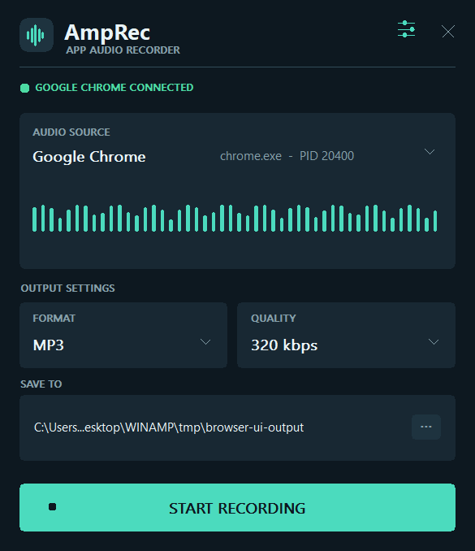
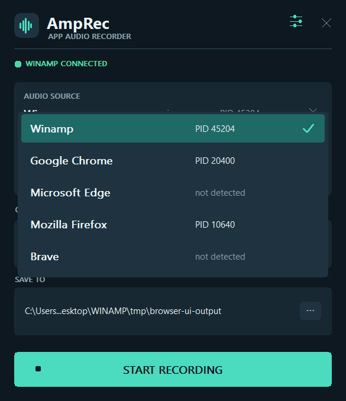
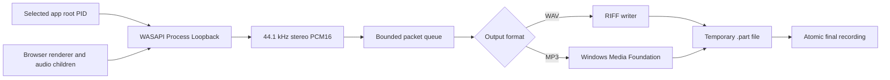

<p align="center">
  
</p>

<h1 align="center">AmpRec</h1>

<p align="center">
  <strong>Record Winamp or browser audio without recording the rest of Windows.</strong>
</p>

<p align="center">
  <a href="https://github.com/ablakateam/AmpRec/releases/latest"></a>
  <a href="https://github.com/ablakateam/AmpRec/actions/workflows/ci.yml"></a>
  
  <a href="LICENSE"></a>
  
</p>

<p align="center">
  
</p>

AmpRec is a compact, native Windows recorder built for one job: save the audio rendered by a selected application process tree. Choose Winamp, Google Chrome, Microsoft Edge, Mozilla Firefox, or Brave; AmpRec records that application and its audio/rendering child processes while excluding unrelated apps, notifications, and microphones.

## Why AmpRec?

| | |
|---|---|
| **Process-isolated capture** | Uses WASAPI Process Loopback instead of recording the entire output device. |
| **Browser-aware** | Selects the browser root and automatically includes its renderer/audio subprocesses. |
| **MP3 and WAV** | Records MP3 at 128, 192, 256, or 320 kbps, or lossless 16-bit stereo PCM WAV. |
| **Safe files** | Writes to a temporary `.part` file and exposes the final recording only after successful finalization. |
| **Tray-first design** | Close the panel while recording, restore it from the notification area, or stop safely from the tray menu. |
| **Private by design** | No accounts, telemetry, cloud service, updater, microphone access, injection, or system-wide fallback. |
| **Portable or installed** | Use the standalone EXE/ZIP or the per-user installer. No Go runtime is required. |

## Source selector

AmpRec collapses a browser's many subprocesses into one selectable application root. If multiple independent roots are running, each is identified by PID. Unavailable applications remain visible so the selection can be saved before launching them.

<p align="center">
  
</p>

## Download and install

Download the newest package from [GitHub Releases](https://github.com/ablakateam/AmpRec/releases/latest):

- **Installer:** `AmpRec-Setup-1.1.0-win-x64.exe` — per-user installation, Start menu shortcut, optional desktop shortcut, and standard uninstaller.
- **Portable:** `AmpRec-1.1.0-win-x64.zip` — extract and run `AmpRec.exe` anywhere.

AmpRec is currently unsigned. Windows SmartScreen may show an unknown-publisher warning; verify the published SHA-256 checksum before running it.

```powershell
Get-FileHash .\AmpRec-Setup-1.1.0-win-x64.exe -Algorithm SHA256
```

## Using AmpRec

1. Start Winamp or a supported browser.
2. Open AmpRec and click the **Audio Source** panel.
3. Select Winamp, Chrome, Edge, Firefox, or Brave. Choose the desired PID if more than one independent instance exists.
4. Choose MP3 or WAV, the MP3 bitrate, and an output folder.
5. Select **Start Recording**. Stop from the window or notification-area menu.

Closing the panel keeps AmpRec running in the tray by default. Recordings are saved as timestamped files. Preferences are stored locally at `%LOCALAPPDATA%\AmpRec\settings.json`.

When Winamp is selected, AmpRec compensates the Winamp player volume and Windows audio-session attenuation once, bounded to +12 dB with saturated PCM conversion. This avoids applying the same attenuation during recording and again during replay.

## How capture works



AmpRec activates `VAD\Process_Loopback` with `PROCESS_LOOPBACK_MODE_INCLUDE_TARGET_PROCESS_TREE`. It never silently falls back to endpoint-wide capture. The queue is bounded, and overload stops with an explicit error rather than dropping audio without warning.

## Requirements and limitations

- Windows 11 x64, or Windows build 20348 or later with Process Loopback support.
- The selected application must render through a capturable shared-mode Windows audio path.
- DRM/protected browser streams may intentionally produce silence.
- Unusual exclusive-mode Winamp output plug-ins may not be capturable.
- Classic WAV output stops before the RIFF 4 GiB limit; RF64 is not emitted.
- The current binaries are not Authenticode-signed.

Record only content you own or have permission to record.

## Build from source

Use 64-bit PowerShell with Go 1.27 or later:

```powershell
git clone https://github.com/ablakateam/AmpRec.git
cd AmpRec
.\scripts\test.ps1
.\scripts\test-integration.ps1
.\scripts\build.ps1
```

The portable executable is written to `dist\AmpRec.exe`. To build the installer, install [Inno Setup 6](https://jrsoftware.org/isinfo.php), then run:

```powershell
.\scripts\build-installer.ps1
```

The integration suite creates deterministic native audio renderers and verifies direct-process MP3 capture, browser child-renderer capture, and exclusion of an unrelated process. It requires a functional Windows audio endpoint.

## Project layout

```text
cmd/amprec/          Entry point, manifest, icons, and version resources
internal/recording/  WASAPI capture, recording lifecycle, MP3, and WAV
internal/ui/         Native Win32 window, rendering, input, and tray behavior
internal/win32/      Process discovery and Windows API helpers
installer/           Reproducible Inno Setup definition
scripts/             Build and verification entry points
testtools/           Deterministic Windows integration fixtures
docs/                Architecture, audit, screenshots, and test results
```

See [Architecture](docs/architecture.md), [Engineering Audit](docs/audit-report.md), and [Test Report](docs/test-report.md) for implementation and verification details.

## Security and contributing

Please report vulnerabilities privately as described in [SECURITY.md](SECURITY.md). Bug reports and focused pull requests are welcome; review [CONTRIBUTING.md](CONTRIBUTING.md) before contributing.

AmpRec is released under the [MIT License](LICENSE).
